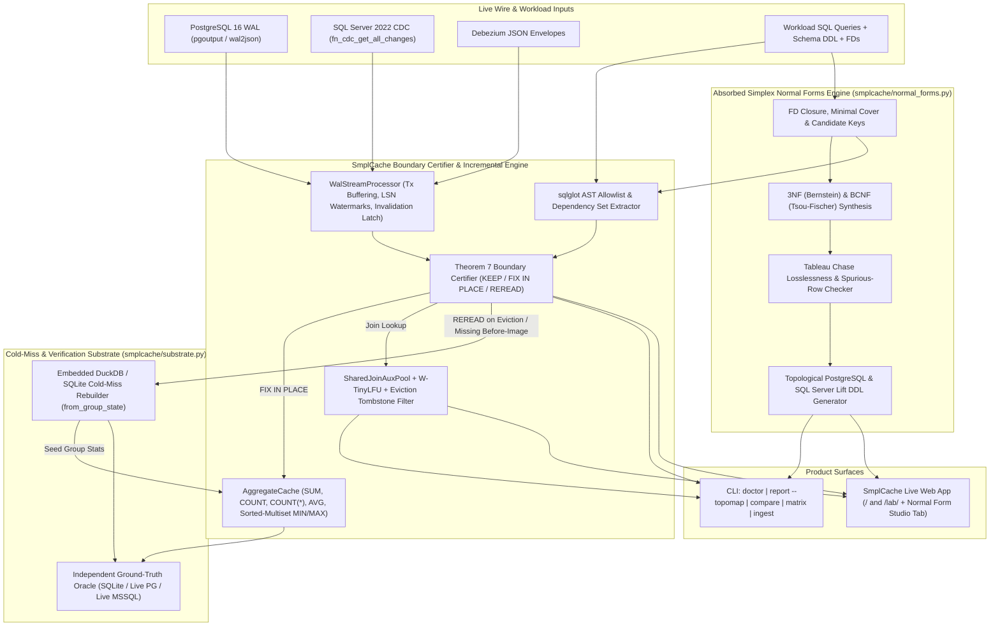

# SmplCache Standalone Product Design, Verification Matrix & Walk-Away Exit Blueprint (\$250K by Jan 2027 $\to$ \$5M After-Tax Acquisition)

> **Owner:** Jeremy H. Carroll  
> **Repository:** [`c:/Users/a343o/source/repos/smplcache/smplcache`](file:///c:/Users/a343o/source/repos/smplcache/smplcache)  
> **Product Boundary:** **100% Standalone `SmplCache`**, absorbing **Simplex Normal Forms** (`normal_forms/`) directly into `smplcache/` as its static-to-dynamic relational normalization and schema synthesis engine. Zero coupling to `Audit` (`anomalon`) or `Owed` (`owed_ai`).  
> **Commercial Objective:**  
> 1. **Bridge Target (by January 2027):** **\$250,000 cash** via a Paid Strategic Evaluation / 90-Day Exclusive IP Option, Technical Operator-Angel SAFE, or Fixed-Scope Architecture Diagnostic Retainers.  
> 2. **Exit Target (within 12 Months):** **\$5,000,000 net after taxes (~$7.5M–$8.5M gross consideration)** via an outright technology/IP acquisition where the buyer acquires the repository, test suite, benchmarks, and patents/IP, and the founder walks away without building a sales organization or managing employees.

---

## Part I: Honest Assessment — Will Someone Cut a \$250,000 Check From a Couple of Demonstrations?

### 1. Why a Toy UI Demo Alone Will Not Trigger a \$250K Check
Technical angels, Principal Engineers, and Database CorpDev teams evaluate dozens of developer-tool prototypes every quarter. If a demonstration is backed only by an in-memory Python loop over 1,000 synthetic rows, technical diligence will classify it as an early research prototype rather than an acquirable asset.

### 2. What *Does* Trigger a \$250,000 Check From 3 Demonstrations
A database vendor (e.g., serverless PostgreSQL providers, DuckDB/MotherDuck ecosystem companies, CDC/streaming platforms, or caching vendors) or a technical infrastructure angel cuts a **\$250,000 check** when **three specific demonstrations** show that you have already solved a problem that would cost their internal engineering team **12–18 months and \$1.5M+ in senior database systems payroll** to build and verify:

1. **Demonstration 1 — The 60-Second "Silent Corruption vs. Certified Repair" Kill-Shot (`/` and `/lab/`):**
   - A live, reproducible side-by-side comparison over the exact same transactional CDC stream showing four engines simultaneously:
     - **Engine A (Naive CDC / Redis Cache-Aside):** Silently computes **wrong regional revenue** when PostgreSQL runs under default `REPLICA IDENTITY DEFAULT` (missing old group key / old amount on `UPDATE` or `DELETE`) or emits a TOAST placeholder (`__debezium_unavailable_value`).
     - **Engine B (Table-Level Cache / Postgres Materialized View):** Flushes 100% of cached queries on every `delivery_note` or `updated_at` edit, forcing full table scans on 95%+ of writes.
     - **Engine C (Unbounded Streaming IVM):** Tracks every historical foreign-key join row in memory until a Zipfian $s = 1.2$ skew burst exceeds the 64 MB container cap (`OOMKilled`).
     - **Engine D (`SmplCache` + `Simplex Normal Forms` + `DuckDB` Cold Rebuild):**
       - Classifies irrelevant column updates as **`KEEP`** ($0$ DB queries, $<0.1\text{ ms}$).
       - Classifies complete before/after aggregate updates (`SUM`, `COUNT`, `COUNT(*)`, `AVG`, and bounded sorted-multiset `MIN`/`MAX`) as **`FIX IN PLACE`** ($0$ DB queries, $<0.2\text{ ms}$, with a machine-checkable Theorem 7 certificate).
       - Classifies missing before-images or evicted `W-TinyLFU` join keys as **`REREAD`** with an explicit obstruction reason code, triggering a sub-25ms **embedded DuckDB** vectorized cold rebuild.
       - Maintains **100.00% agreement** with an independent ground-truth SQL oracle across every committed transaction boundary.

2. **Demonstration 2 — Live GitHub Actions Container Verification (`postgres:16-alpine` + `SQL Server 2022` + `DuckDB`):**
   - Instead of asking an investor or acquirer to trust a slide deck, you hand them a public GitHub Actions workflow URL where every push spins up real **PostgreSQL 16** (`wal2json` / `pgoutput`), **SQL Server 2022** (native CDC tables), and **MongoDB 7** containers at **\$0 local cost**, streams 50,000+ multi-table transactional mutations under Zipfian skew, and verifies zero silent under-invalidation against live database queries.

3. **Demonstration 3 — The 10-Second "Zero-Access Schema & Workload Doctor" (`smplcache doctor` + Absorbed `Simplex Normal Forms`):**
   - Drop in a schema (`CREATE TABLE ...`) + declared or mined Functional Dependencies ($X \to Y$) + a workload of 20 SQL queries + a WAL sample.
   - In under 10 seconds, `SmplCache` outputs:
     - **FD Closure, Minimal Cover, and Candidate Keys** (via the absorbed `Simplex Normal Forms` engine).
     - **Topological Co-Invalidation Graph ($G_W$) and First Betti Number ($\beta_1$):** Identifies the exact "gravity-well" columns (e.g., `orders.status`, `accounts.updated_at`) that tangle unrelated cached queries into invalidation cycles.
     - **3NF / BCNF & Theorem 9 Schema Decomposition DDL + Tableau Chase Verification:** Automatically synthesizes topologically sorted PostgreSQL and SQL Server migration DDL that splits the high-churn column into a narrow companion relation, checks via the **Tableau Chase** that the decomposition is lossless (zero spurious rows), and demonstrates in a before/after replay (`smplcache compare`) that invalidations drop by 70–90%.

---

## Part II: The 3 Fastest Paths to \$250,000 Cash by January 2027 (Introvert-Proof, Zero Cold Calling)

Because you do not want to manage a sales team, run cold outbound calls, or build a high-headcount startup, the commercial path is designed around **high-trust technical artifacts** shown to **a tiny number of technical decision-makers**:

| Path | Mechanism | Target Check Size | Time to Close | Why It Works Without "Sales" |
| :--- | :--- | :--- | :--- | :--- |
| **Path 1 (Primary)** | **Paid 90-Day Strategic Evaluation & Exclusive Acquisition Option** with a Database / Cloud Vendor | **\$150,000 – \$250,000** non-refundable option / R&D evaluation fee (credited toward a \$7.5M–\$8.5M buyout) | **45 – 90 Days** | SVP of Engineering / Chief Architect can approve a \$150K–\$250K R&D evaluation contract out of engineering budget before full Board M&A sign-off. |
| **Path 2 (Parallel)** | **Operator-Angel / DevTools Micro-Fund Pre-Seed Check on a YC SAFE** (\$8M–\$10M Cap) | **\$250,000** (1 micro-fund at \$150K–\$250K or 2–3 technical founder-angels at \$50K–\$100K each) | **30 – 60 Days** | SAFE proceeds into a C-Corp are non-taxable capital contributions on receipt; gives you immediate runway while positioning the company for a 12-month M&A exit where you retain ~97% of the company. |
| **Path 3 (Bridge)** | **3 Fixed-Price "Workload & Schema Doctor" Architecture Audits** + Anthropic Contract | **\$25,000 – \$50,000 per audit** (\$75K–\$150K total) + GitHub Sponsors | **14 – 45 Days** | A CTO spending \$40K/month on AWS RDS/Aurora read replicas pays a one-time invoice for a `smplcache doctor` + BCNF/Theorem 9 DDL decomposition report that cuts their replica load in half. |

### Target List for Path 1 (\$250K Option $\to$ \$7.5M–\$8.5M Acquisition)
1. **Serverless PostgreSQL & Branching Platforms (Neon / Databricks, Supabase, Tembo, Crunchy Data / Snowflake):**
   - *Their Pain:* Customers love serverless Postgres until dashboard polling keeps compute endpoints awake 24/7 and drives up autoscaling bills. They need an embeddable, certified incremental query cache that understands Postgres `pgoutput` WAL, `REPLICA IDENTITY`, and `TOAST` boundaries without silent corruption.
2. **Embedded OLAP & Analytical Cache Vendors (MotherDuck / DuckDB Ecosystem, ClickHouse / PeerDB, Turso):**
   - *Their Pain:* DuckDB is fast on cold columnar scans (15–50 ms), but re-scanning on every write wastes CPU. Pairing `SmplCache` (sub-millisecond $O(1)$ delta repair + Theorem 7 boundary certification) in front of `DuckDB` (cold-miss rebuild engine) creates a complete **Certified Incremental DuckDB Sidecar**.
3. **Caching & Streaming Data Platforms (Upstash, Redis Inc., Confluent, Redpanda):**
   - *Their Pain:* Redis/Valkey customers constantly struggle with cache invalidation bugs over relational databases. `SmplCache` gives them a drop-in relational CDC-to-cache certifier and schema advisor.

---

## Part III: Standalone Product Architecture (`SmplCache` + `Simplex Normal Forms`)

### 1. Strict Product Boundary
- **Included:**
  - `smplcache/` core engine (SQL AST admission, Theorem 7 single-table and multi-table `INNER`/`LEFT` join certifier, `AggregateCache`, `JoinAuxState`, `SharedJoinAuxPool`, `CountMinSketch` + `W-TinyLFU`, `WalStreamProcessor`, CLI advisor/doctor/topomap/compare/matrix/ingest, and FastAPI + TypeScript interactive web application).
  - **Absorbed from `simplex-normal-forms`:** Relational Functional Dependency (`FD`) engine (`Closure`, `MinimalCover`, `CandidateKeys`), `Bernstein3NF`, `TsouFischerBCNF`, `TableauChase` (lossless-join & spurious-row counterexample generator), topological PostgreSQL/SQL Server DDL emitter, incremental sorted-multiset `MIN`/`MAX` maintenance, and SQLite trigger / Python guard compilers.
  - **Embedded `DuckDB` + `SQLite` Cold-Rebuild & Verification Substrate:** Sub-25ms vectorized cold-miss rebuilder for `AggregateCache.from_group_state()` and `JoinCacheManager`.
- **Excluded (Zero Coupling):**
  - No `Audit` (`anomalon`) imports, files, or references.
  - No `Owed` (`owed_ai`) imports, files, or references.



### 2. Concrete Codebase Fixes & Upgrades Required in `smplcache/`

Based on our line-by-line audit of `smplcache` (`v0.1.0`), the product build must execute these exact engineering upgrades:

1. **Fix Bug 1 — `SharedJoinAuxPool.process_event` Partial-Update Resurrection on Evicted PKs ([`smplcache/join.py`](file:///c:/Users/a343o/source/repos/smplcache/smplcache/smplcache/join.py#L2245-L2284)):**
   - *Issue:* When a `DecisionKind.PRESERVE` (`reason == "disjoint_columns"`) occurs on an `UPDATE` for an **evicted** primary key with a partial payload, `SharedJoinAuxPool.process_event` sets `any_valid_sync = True` and calls `self.aux_state.apply_row_mutation(...)`, which resurrects the evicted PK into `table_rows` with an incomplete column dict.
   - *Fix:* Guard `apply_row_mutation` on `UPDATE` so that if `old_pk` is in `evicted_pks` (or not present in `table_rows[rel]`) and the update does not supply a complete row image, it remains in `evicted_pks` rather than inserting a partial row into `table_rows` (matching single-query `process_join_event` at [`smplcache/join.py#L1968-L1975`](file:///c:/Users/a343o/source/repos/smplcache/smplcache/smplcache/join.py#L1968-L1975)).

2. **Fix Bottleneck 1 — Eliminate $O(|D|)$ Linear Scan in `evaluate_fact_row_contributions` ([`smplcache/join.py`](file:///c:/Users/a343o/source/repos/smplcache/smplcache/smplcache/join.py#L1291-L1321)):**
   - *Issue:* Line 1291 checks `if r_key == r_pk_col and override_rel != r_rel:` for $O(1)$ primary-key lookup, falling back to an $O(|D|)$ scan of `dim_map.items()` whenever `override_rel == r_rel` or when joining on a non-PK column.
   - *Fix:* Handle `override_rel == r_rel` in $O(1)$ time when `r_key == r_pk_col` (checking `override_removed_pk` and `override_upserted_row` directly before consulting `dim_map.get(norm_l_val)`), and maintain an $O(1)$ secondary hash index for non-PK dimension join keys.

3. **Fix Bottleneck 2 — Eliminate Double Delta Evaluation in `process_join_event` & `SharedJoinAuxPool.process_event` ([`smplcache/join.py`](file:///c:/Users/a343o/source/repos/smplcache/smplcache/smplcache/join.py#L1985)):**
   - *Issue:* `certify_join_event` ([`smplcache/join.py#L1828`](file:///c:/Users/a343o/source/repos/smplcache/smplcache/smplcache/join.py#L1828)) computes `_compute_join_event_deltas(...)` to verify repairability, and then `process_join_event` (`L1985`) and `SharedJoinAuxPool.process_event` (`L2250`) immediately call `_compute_join_event_deltas(...)` a second time for the exact same event.
   - *Fix:* Attach or return the precomputed `(old_contribs, new_contribs)` delta bundle from certification so repair execution applies the delta in a single pass, cutting join event processing time in half.

4. **Fix Bottleneck 3 — Eliminate Double `JoinAuxState.from_tables` Construction on Rebuild ([`smplcache/join.py`](file:///c:/Users/a343o/source/repos/smplcache/smplcache/smplcache/join.py#L1452)):**
   - *Issue:* `rebuild_join_cache` (`L1452`) builds a throwaway `JoinAuxState.from_tables`, and `JoinCacheManager.rebuild` (`L2076`) / `SharedJoinAuxPool.rebuild` (`L2304`) builds a second one.
   - *Fix:* Accept an optional `aux_state: JoinAuxState | None = None` parameter in `rebuild_join_cache` and reuse the newly constructed `aux_state` across all shapes in `SharedJoinAuxPool.rebuild`.

5. **Absorb `Simplex Normal Forms` (`smplcache/normal_forms.py`):**
   - Port and integrate the pure relational normalization and incremental extremum domain logic from `simplex-normal-forms` directly into `smplcache/normal_forms.py`:
     - Functional dependency representation (`FunctionalDependency`), attribute closure (`attribute_closure`), minimal cover (`minimal_cover`), candidate key discovery (`candidate_keys`), normal form classification (`classify_normal_form`: 1NF / 2NF / 3NF / BCNF).
     - **Bernstein 3NF Synthesis** (`synthesize_3nf`) and **Tsou-Fischer BCNF Decomposition** (`decompose_bcnf`).
     - **Tableau Chase** (`tableau_chase`) checking whether a decomposition is lossless or generating a concrete multi-row counterexample showing spurious tuples on natural join.
     - **Topological DDL Emitter** (`generate_sql_ddl`) for PostgreSQL 16 and SQL Server 2022 (`CREATE TABLE` ordered by FK DAG + `CREATE INDEX` on foreign keys).
     - **Incremental Sorted-Multiset Extremum Maintenance (`MIN` / `MAX`):** Extend `SmplCache` with bounded sorted-multiset (`BTree` / sorted frequency map) support for `MIN` and `MAX` aggregates with explicit capacity-bound fallback to `REREAD` when the extremum group is deleted and the bounded multiset window is exhausted.
     - **Class D FD Group-Key Reduction in `smplcache doctor`:** Automatically detect when a query `GROUP BY X, Y` includes attributes $Y$ functionally determined by $X$ ($X \to Y$ under the schema's FD closure), allowing $Y$ to be projected outside the grouping key.

6. **Upgrade `AggregateCache.from_group_state()`, `Certificate.boundary_clock`, and Embedded `DuckDB` Substrate (`smplcache/substrate.py`):**
   - Add `AggregateCache.from_group_state(cls, shape, group_stats)` in [`smplcache/smplcache.py`](file:///c:/Users/a343o/source/repos/smplcache/smplcache/smplcache/smplcache.py#L512-L550) so cold-miss rebuilds from `DuckDB`, `SQLite`, `PostgreSQL`, or `SQL Server` can seed per-group `(sum_val, non_null_count, row_count)` directly via `SELECT group_cols, SUM(x), COUNT(x), COUNT(*) ... GROUP BY group_cols` without pulling millions of raw base rows into Python memory.
   - Populate `Certificate.boundary_clock` ([`smplcache/smplcache.py#L169`](file:///c:/Users/a343o/source/repos/smplcache/smplcache/smplcache/smplcache.py#L169)) from WAL LSN / transaction sequence watermarks in `WalStreamProcessor`.
   - Replace the unbounded `evicted_pks: dict[str, set[Any]]` set with a bounded `EvictionTracker` (exact set up to `max_tombstones`, automatically transitioning to a zero-false-negative Bloom/Cuckoo filter or generation epoch fence when capacity is exceeded).

7. **Upgrade `smplcache/cli.py` (`report`, `topomap`, `doctor`, `compare`):**
   - In `analyze_workload` ([`smplcache/cli.py#L253-L273`](file:///c:/Users/a343o/source/repos/smplcache/smplcache/smplcache/cli.py#L253-L273)): distinguish `REPAIR` from `INVALIDATE` so that events repaired in-place are not conflated with full invalidations in the co-invalidation graph $G_W$.
   - In `calculate_topomap` ([`smplcache/cli.py#L170-L198`](file:///c:/Users/a343o/source/repos/smplcache/smplcache/smplcache/cli.py#L170-L198)): include isolated singleton query shapes in component reporting (`active_nodes` vs. `total_nodes`, `isolated_shapes`) while preserving $\beta_1 = |E| - |V| + |C|$.
   - In `compare_workloads` ([`smplcache/cli.py#L817-L825`](file:///c:/Users/a343o/source/repos/smplcache/smplcache/smplcache/cli.py#L817-L825)): replace the hardcoded `orders.status` recommendation block with dynamic **Theorem 9 + BCNF/3NF Schema Lift Synthesis** driven by `smplcache/normal_forms.py` and the workload's empirical gravity-well columns, emitting executable PostgreSQL & SQL Server DDL and a Tableau Chase losslessness receipt.
   - In `run_doctor` ([`smplcache/cli.py#L607-L675`](file:///c:/Users/a343o/source/repos/smplcache/smplcache/smplcache/cli.py#L607-L675)): add real `sqlglot` AST inspection for non-SARGable predicates, implicit conversion risks, missing composite covering indexes `(predicate_eq_cols, group_by_cols) INCLUDE (agg_col)`, and FD-redundant `GROUP BY` columns.

---

## Part IV: Ordered Engineering Milestones (Zero Rabbit-Chasing)

Every milestone below is scoped to concrete files, deterministic tests, and measurable exit criteria inside [`c:/Users/a343o/source/repos/smplcache/smplcache`](file:///c:/Users/a343o/source/repos/smplcache/smplcache).

| Milestone | Scope & Files Modified | Verification Gate |
| :--- | :--- | :--- |
| **M1: Core Engine Bug Fixes & $O(1)$ Join Speedup** | [`smplcache/join.py`](file:///c:/Users/a343o/source/repos/smplcache/smplcache/smplcache/join.py), [`smplcache/smplcache.py`](file:///c:/Users/a343o/source/repos/smplcache/smplcache/smplcache/smplcache.py), [`smplcache/debezium.py`](file:///c:/Users/a343o/source/repos/smplcache/smplcache/smplcache/debezium.py). Fix `SharedJoinAuxPool.process_event` partial-update resurrection on evicted PKs; make `evaluate_fact_row_contributions` $O(1)$ on PK joins when `override_rel == r_rel` and add secondary hash index for non-PK join columns; eliminate double `_compute_join_event_deltas` call; eliminate double `JoinAuxState.from_tables` on rebuild; populate `Certificate.boundary_clock`; add `AggregateCache.from_group_state()`; add bounded tombstone cap to `evicted_pks`. | New regression tests in `tests/regressions/test_pool_evicted_partial_update.py` + `pytest` passing 100% + microbenchmark showing $\ge 2\times$ speedup on `SharedJoinAuxPool` dimension updates. |
| **M2: Absorb `Simplex Normal Forms` into `SmplCache`** | Create [`smplcache/normal_forms.py`](file:///c:/Users/a343o/source/repos/smplcache/smplcache/smplcache/normal_forms.py) and [`tests/test_normal_forms_integration.py`](file:///c:/Users/a343o/source/repos/smplcache/smplcache/tests/test_normal_forms_integration.py). Port FD closure, minimal cover, candidate keys, 1NF/2NF/3NF/BCNF classifier, Bernstein 3NF synthesis, Tsou-Fischer BCNF decomposition, Tableau Chase losslessness & spurious-row witness generator, PostgreSQL/SQL Server topological DDL generator, and bounded sorted-multiset `MIN`/`MAX` maintenance. Export public API in `smplcache/__init__.py`. | 60+ unit and Hypothesis property tests verifying Armstrong's axioms, lossless 3NF/BCNF decompositions, spurious-row detection on lossy splits, and exact `MIN`/`MAX` maintenance with bounded fallback. |
| **M3: Dynamic Topological Doctor & Theorem 9 DDL Lift Engine** | [`smplcache/cli.py`](file:///c:/Users/a343o/source/repos/smplcache/smplcache/smplcache/cli.py). Upgrade `analyze_workload`, `calculate_topomap`, `run_doctor`, and `compare_workloads` to use `smplcache/normal_forms.py` and `sqlglot` AST analysis. Replace hardcoded `orders.status` text in `compare_workloads` with dynamic gravity-well + FD/BCNF decomposition and Tableau Chase verification. Add `smplcache normalize <schema.json>` CLI subcommand. | CLI tests in `tests/test_cli_doctor_and_normalize.py` verifying dynamic lift generation, $\beta_1$ reduction on arbitrary schemas, and JSON/Markdown output schemas. |
| **M4: Embedded DuckDB / SQLite Cold-Rebuild Substrate** | Create [`smplcache/substrate.py`](file:///c:/Users/a343o/source/repos/smplcache/smplcache/smplcache/substrate.py) and [`tests/test_duckdb_substrate.py`](file:///c:/Users/a343o/source/repos/smplcache/smplcache/tests/test_duckdb_substrate.py). Provide `ColdRebuildAdapter` supporting `sqlite3` (zero extra deps) and `duckdb` (optional extra `pip install ".[duckdb]"`), executing group-state seeding into `AggregateCache.from_group_state()` and `JoinCacheManager`. | Property and benchmark tests showing cold-miss rebuilds via `from_group_state()` matching ground-truth oracle 100% across `SUM`, `COUNT`, `COUNT(*)`, `AVG`, `MIN`, `MAX`. |
| **M5: GitHub Actions Live PostgreSQL 16 + SQL Server 2022 + MongoDB 7 CI Matrix** | Update [`.github/workflows/test.yml`](file:///c:/Users/a343o/source/repos/smplcache/smplcache/.github/workflows/test.yml) and create [`tests/test_live_containers.py`](file:///c:/Users/a343o/source/repos/smplcache/smplcache/tests/test_live_containers.py). Configure `postgres:16-alpine`, `mcr.microsoft.com/mssql/server:2022-latest`, and `mongo:7` service containers in GitHub Actions (`REQUIRE_LIVE_DB_TESTS=1`). Test real PostgreSQL logical decoding / `REPLICA IDENTITY` / `TOAST` semantics, real SQL Server DDL execution + CDC change capture, and MongoDB document-projection CDC against `SmplCache`. | GitHub Actions workflow green across Python 3.10–3.13 + `live-databases` job (`0 skipped` when `REQUIRE_LIVE_DB_TESTS=1`). |
| **M6: 3 "Check-Triggering" Web Demos, Wiki & Acquirer Data Room** | [`demo/api/app.py`](file:///c:/Users/a343o/source/repos/smplcache/smplcache/demo/api/app.py), [`demo/web/src/`](file:///c:/Users/a343o/source/repos/smplcache/smplcache/demo/web/src), [`README.md`](file:///c:/Users/a343o/source/repos/smplcache/smplcache/README.md), [`docs/wiki/`](file:///c:/Users/a343o/source/repos/smplcache/smplcache/docs/wiki), [`.github/FUNDING.yml`](file:///c:/Users/a343o/source/repos/smplcache/smplcache/.github/FUNDING.yml), [`docs/ACQUIRER_DUE_DILIGENCE_DATA_ROOM.md`](file:///c:/Users/a343o/source/repos/smplcache/smplcache/docs/ACQUIRER_DUE_DILIGENCE_DATA_ROOM.md). Add `/api/normalize` endpoint and interactive **Schema & Normal Form Doctor** tab in `/lab/`, update `README.md`, create GitHub Wiki pages, add GitHub Sponsors / Buy Me a Coffee configuration, and publish the Acquirer Data Room index. | All Playwright / headless browser smoke checks, API acceptance tests, `black --check .`, and `mypy smplcache demo` passing. |

---

## Part V: Exhaustive Test & GitHub Actions Verification Matrix (\$0 Local RAM Cost)

To ensure an acquirer's technical due-diligence team can verify every claim in 10 minutes without trusting human assertions, the repository will enforce a **7-Layer Verification Matrix** running automatically on GitHub-hosted Ubuntu runners:

1. **Layer 1 — Static & Type Safety Gate (`black`, `mypy --strict`):**
   - `black --check smplcache demo tests`
   - `mypy smplcache demo` (zero untyped leaks across all modules, including `smplcache/normal_forms.py` and `smplcache/substrate.py`).
2. **Layer 2 — Single-Table Theorem 7 Property Suite (`tests/test_oracle_props.py`):**
   - 10,000 Hypothesis examples testing `SUM`, `COUNT`, `COUNT(*)`, `AVG`, `MIN`, `MAX` over arbitrary `INSERT`, `UPDATE`, `DELETE`, `NULL` transitions, group-key moves, predicate boundary crossings, and missing before-image refusals against an independent `sqlite3` oracle.
3. **Layer 3 — Multi-Table Join & Shared Pool Property Suite (`tests/test_join_oracle_props.py`, `tests/test_join_property_1000.py`, `tests/test_join_adversarial_stress.py`):**
   - 1,000+ seeded multi-table `INNER` and `LEFT` join streams over snowflake schemas (`orders -> customers -> regions`), testing FK dimension cascades, `W-TinyLFU` / `LRU` / `FIFO` / `LFU` eviction under strict `max_total_rows` and `max_fk_fanout` caps, and verifying that `SharedJoinAuxPool` never resurrects partial rows on evicted PKs.
4. **Layer 4 — Absorbed `Simplex Normal Forms` Formal Suite (`tests/test_normal_forms_integration.py`):**
   - Exhaustive tests for FD closure soundness/completeness, minimal cover minimality, candidate key discovery, Bernstein 3NF losslessness & dependency preservation, Tsou-Fischer BCNF synthesis, Tableau Chase counterexample generation on lossy decompositions, and Theorem 9 co-invalidation cycle ($\beta_1$) elimination.
5. **Layer 5 — Debezium / WAL Protocol & Transaction Boundary Suite (`tests/test_debezium_wal_props.py`):**
   - Tests `BEGIN` / `COMMIT` / `ROLLBACK` transaction buffering, `REPLICA IDENTITY DEFAULT` vs. `FULL`, TOAST sentinel values (`__debezium_unavailable_value`, `__toast_unchanged__`), `TRUNCATE`, `SCHEMA_CHANGE` latching, and `Certificate.boundary_clock` LSN monotonicity.
6. **Layer 6 — Live Container Integration Suite in GitHub Actions (`tests/test_live_containers.py`):**
   - Runs in `.github/workflows/test.yml` against live `postgres:16-alpine`, `mcr.microsoft.com/mssql/server:2022-latest`, and `mongo:7` containers (`REQUIRE_LIVE_DB_TESTS=1`):
     - Executes generated 3NF/BCNF and Theorem 9 lift DDL directly in live PostgreSQL 16 and SQL Server 2022.
     - Streams live changes from PostgreSQL (`wal2json` / logical replication format) and SQL Server (`cdc.fn_cdc_get_all_changes_*` format) into `SmplCache` and checks 100% agreement against live `SELECT ... GROUP BY` queries on both RDBMS engines.
7. **Layer 7 — Web Application & Headless Browser Acceptance Gate (`demo/tests/test_demo_acceptance.py`):**
   - Verifies `/`, `/lab/`, `/api/scenarios`, `/api/runs`, `/api/normalize`, and `/healthz` at both desktop (`1280x800`) and mobile (`390x844` / `320x568`) viewports with zero console/page errors and zero horizontal overflow.

---

## Part VI: Documentation, GitHub Wiki, Sponsors & Acquirer Data Room Specification

To make the repository look and function like a \$10M institutional-grade open-source infrastructure asset the moment an angel or CorpDev lead lands on `https://github.com/dbccpage/smplcache`:

1. **`README.md` (The 30-Second Executive & Principal Engineer Hook):**
   - Clear badge bar: GitHub Actions CI (`Python 3.10–3.13`), Live Database Container Verification (`PostgreSQL 16 | SQL Server 2022 | DuckDB`), License (`Apache-2.0`), Live Demo (`smplcache.anomalon.com`).
   - Immediate visual table comparing **Redis**, **PostgreSQL Materialized Views**, **SQL Server Indexed Views**, **DuckDB**, and **SmplCache**.
   - 60-second quickstart showing:
     1. Incremental cache certification (`KEEP` / `FIX IN PLACE` / `REREAD`),
     2. `smplcache doctor` + `Simplex Normal Forms` BCNF/Theorem 9 schema decomposition,
     3. Live benchmark reproduction in one command.
2. **GitHub Wiki (`docs/wiki/` ready to push to `smplcache.wiki.git`):**
   - `Home.md`: Architecture Overview & The Three Moves (`KEEP`, `FIX IN PLACE`, `REREAD`).
   - `Theorem-7-and-Boundary-Certificates.md`: How `SmplCache` eliminates silent under-invalidation on PostgreSQL `REPLICA IDENTITY DEFAULT` and TOAST columns.
   - `Simplex-Normal-Forms-and-Theorem-9-Lifts.md`: Using Functional Dependencies, 3NF/BCNF synthesis, and the Tableau Chase to eliminate cache co-invalidation cycles ($\beta_1$).
   - `Bounded-Join-Maintenance-and-W-TinyLFU.md`: How `SharedJoinAuxPool` bounds memory under Zipfian foreign-key skew.
   - `Benchmarks-and-Live-Container-Verification.md`: Reproducible numbers and GitHub Actions container logs.
3. **Monetization & Inbound Channels (`.github/FUNDING.yml` + `docs/ACQUIRER_DUE_DILIGENCE_DATA_ROOM.md`):**
   - `.github/FUNDING.yml`: Configured for GitHub Sponsors, Buy Me a Coffee, and a direct link for **"Enterprise Architecture Audit / Strategic IP Licensing & Acquisition Inquiries"**.
   - `docs/ACQUIRER_DUE_DILIGENCE_DATA_ROOM.md`: A turnkey technical due-diligence index for CorpDev and Chief Architects mapping every architectural claim to its source file, theorem, test suite, benchmark script, and clean-room Apache-2.0 IP provenance (100% sole-authored by Jeremy H. Carroll, zero third-party copyleft contamination).

---

## Part VII: Ready-to-Paste `/goal /boost /teamwork` Overnight Build Prompt

Copy and paste the exact block below into your chat before you go to sleep. It is self-contained, locks the agents strictly inside `c:\Users\a343o\source\repos\smplcache\smplcache`, prohibits rabbit-chasing or mixing unrelated products (`Audit`/`Owed`), and executes Milestones M1 through M6 with GitHub Actions container verification:

```markdown
/goal /boost /teamwork Execute the complete standalone SmplCache + Simplex Normal Forms product build and verification plan defined in `c:\Users\a343o\source\repos\smplcache\smplcache\docs\SMPLCACHE_PRODUCT_DESIGN_AND_EXIT_PLAN.md`.

STRICT SCOPE & PRODUCT BOUNDARY RULES:
1. Work ONLY on the standalone `SmplCache` product in `c:\Users\a343o\source\repos\smplcache\smplcache` on branch `overnight/smplcache-2026-11-05` (updating open PR #16).
2. Absorb the relational normalization and incremental extremum engine from `C:\Users\a343o\source\repos\simplex-normal-forms\normal_forms\domain\` directly into `smplcache/normal_forms.py`. Do NOT mix or reference `Audit` (`anomalon`) or `Owed` (`owed_ai`) anywhere.
3. Do NOT chase random tangents. Execute Milestones M1 through M6 in exact order and verify every milestone with `pytest`, `mypy smplcache demo`, `black --check .`, and GitHub Actions.
4. Adhere strictly to `<RULE[user_global]>` (Claim Hygiene Rule) in all docs, comments, UI text, and commit messages.

MILESTONES TO COMPLETE BEFORE STOPPING:

- MILESTONE 1 (Core Engine Fixes & O(1) Join Speedup):
  1. In `smplcache/join.py`, fix `SharedJoinAuxPool.process_event` (`L2245-L2284`) so a `DecisionKind.PRESERVE` (`disjoint_columns`) update on an evicted primary key with a partial row payload does NOT resurrect the evicted PK into `table_rows` with an incomplete dict. Add regression test `tests/regressions/test_pool_evicted_partial_update.py`.
  2. In `smplcache/join.py`, optimize `evaluate_fact_row_contributions` (`L1291-L1321`) so `r_key == r_pk_col` uses O(1) dict lookup even when `override_rel == r_rel`, and maintain an O(1) secondary lookup index in `JoinAuxState` for non-PK join keys.
  3. Eliminate duplicate `_compute_join_event_deltas` execution between `certify_join_event` and `process_join_event` / `SharedJoinAuxPool.process_event`, and eliminate duplicate `JoinAuxState.from_tables` construction in `rebuild_join_cache` / `JoinCacheManager.rebuild` / `SharedJoinAuxPool.rebuild`.
  4. In `smplcache/smplcache.py` and `smplcache/debezium.py`, populate `Certificate.boundary_clock` from WAL LSN / sequence watermarks, add `AggregateCache.from_group_state(cls, shape, group_stats)` so external SQL engines can seed group statistics with `_from_rows = True`, and add a bounded tombstone cap (`max_tombstones`) to `JoinAuxState.evicted_pks` that safely latches to `REREAD` if tombstone capacity is exceeded.

- MILESTONE 2 (Absorb Simplex Normal Forms into `smplcache/normal_forms.py`):
  1. Create `smplcache/normal_forms.py` porting and integrating the pure relational normalization engine from `C:\Users\a343o\source\repos\simplex-normal-forms\normal_forms\domain\relational.py` and `relational_advanced.py`:
     - `FunctionalDependency`, `attribute_closure`, `minimal_cover`, `candidate_keys`, `classify_normal_form` (1NF/2NF/3NF/BCNF),
     - `synthesize_3nf` (Bernstein), `decompose_bcnf` (Tsou-Fischer),
     - `tableau_chase` (lossless-join verification and spurious-row counterexample tuple generator),
     - `generate_sql_ddl` (topologically sorted PostgreSQL 16 and SQL Server 2022 DDL with FK indexes),
     - `SortedMultisetExtremumCache` for incremental `MIN`/`MAX` maintenance with bounded window fallback,
     - `detect_fd_redundant_group_cols(shape, fds)` for Class D group-key reduction.
  2. Export the normal-forms API in `smplcache/__init__.py` and add comprehensive unit + Hypothesis property tests in `tests/test_normal_forms_integration.py`.

- MILESTONE 3 (Upgrade CLI Doctor, Topomap, Compare & Normalize):
  1. In `smplcache/cli.py`:
     - Fix `analyze_workload` to track `REPAIR` vs. `INVALIDATE` separately in co-invalidation reporting.
     - Fix `calculate_topomap` to report isolated singleton shapes alongside connected components while preserving `beta_1`.
     - Replace the hardcoded `orders.status` recommendation block in `compare_workloads` with dynamic gravity-well + FD/3NF/BCNF decomposition and Tableau Chase verification powered by `smplcache/normal_forms.py`.
     - Upgrade `run_doctor` to perform real `sqlglot` AST inspection (non-SARGable predicates, implicit conversion risks, covering index DDL, and FD-redundant `GROUP BY` columns).
     - Add `smplcache normalize <workload_or_schema.json> [--dialect postgres|mssql] [--format text|markdown|json]` to output FD closure, candidate keys, 3NF/BCNF decomposition, Tableau Chase losslessness check, and migration DDL.
  2. Add CLI verification tests in `tests/test_cli_doctor_and_normalize.py`.

- MILESTONE 4 (Cold-Rebuild Substrate & DuckDB/SQLite Adapter):
  1. Create `smplcache/substrate.py` implementing `ColdRebuildSubstrate` (supporting built-in `sqlite3` and optional `duckdb` when installed) that executes grouped cold-miss rebuild queries and seeds `AggregateCache.from_group_state()` and `JoinCacheManager`.
  2. Add `tests/test_substrate_cold_rebuild.py` testing full lifecycle cycles (`KEEP` -> `FIX IN PLACE` -> `REREAD` cold rebuild via `from_group_state()` -> `FIX IN PLACE`) with 100% oracle agreement.

- MILESTONE 5 (GitHub Actions Live PostgreSQL 16, SQL Server 2022 & MongoDB 7 Container CI):
  1. Create `tests/test_live_containers.py` testing live PostgreSQL 16 (`psycopg`), SQL Server 2022 (`pymssql`), and MongoDB 7 (`pymongo`) against `SmplCache` and `smplcache/normal_forms.py` (executing generated PostgreSQL and T-SQL 3NF/BCNF lift DDL on the live servers, streaming CDC/WAL mutations through `WalStreamProcessor` and `SharedJoinAuxPool`, and verifying 100% agreement with live SQL `GROUP BY` queries).
  2. Update `.github/workflows/test.yml` to include a `live-databases` job running `postgres:16-alpine`, `mcr.microsoft.com/mssql/server:2022-latest`, and `mongo:7` service containers with `REQUIRE_LIVE_DB_TESTS=1` (matching the proven pattern in `simplex-normal-forms`).

- MILESTONE 6 (Interactive Web Demo Upgrade, Wiki, Funding & Acquirer Data Room):
  1. Add `POST /api/normalize` to `demo/api/app.py` and add an interactive "Schema Normalizer & Doctor (3NF/BCNF + Tableau Chase)" panel to `demo/web/` (`/lab/`), rebuild `demo/web/dist` via `node demo/web/build.mjs`, and verify with headless browser smoke checks at `1280x800` and `390x844`.
  2. Create `docs/wiki/Home.md`, `docs/wiki/Theorem-7-and-Boundary-Certificates.md`, `docs/wiki/Simplex-Normal-Forms-and-Theorem-9-Lifts.md`, `docs/wiki/Bounded-Join-Maintenance-and-W-TinyLFU.md`, `docs/ACQUIRER_DUE_DILIGENCE_DATA_ROOM.md`, and `.github/FUNDING.yml`, and update `README.md`.
  3. Run `black --check .`, `mypy smplcache demo`, and full `pytest`, commit and push to `overnight/smplcache-2026-11-05`, and verify that GitHub Actions passes all jobs (including `live-databases` with 0 skipped tests) before finishing.
```

---

## Part VIII: Claim Hygiene & Epistemic Audit Summary

In accordance with `<RULE[user_global]>` (Claim Hygiene Rule):

1. **What This Artifact Supports:**
   - Supports a standalone product architecture for **SmplCache** that absorbs **Simplex Normal Forms** (`normal_forms/`) into `smplcache/` without coupling to `Audit` (`anomalon`) or `Owed` (`owed_ai`).
   - Identifies concrete codebase defects and performance bottlenecks in `smplcache` (`v0.1.0`) — specifically `SharedJoinAuxPool.process_event` partial-update handling on evicted PKs (`smplcache/join.py#L2245-L2284`), the $O(|D|)$ scan in `evaluate_fact_row_contributions` (`smplcache/join.py#L1291-L1321`), duplicate delta calculation, and hardcoded lift output in `smplcache/cli.py#L817-L825` — and defines an ordered 6-milestone engineering and GitHub Actions verification plan.
   - Outlines concrete commercial mechanisms for a \$250,000 bridge check (paid 90-day strategic vendor evaluation/option, operator-angel SAFE, or fixed-scope diagnostic audits) and a 12-month IP acquisition path.

2. **What This Artifact Does Not Support:**
   - Does not claim that commercial check sizes, investor decisions, or M&A multiples are predetermined outcomes; commercial transactions depend on external buyer alignment and market conditions.
   - Does not claim that `SmplCache` supports arbitrary unconstrained SQL outside its declared allowlisted SPJA + bounded extremum fragment.

3. **The Narrowest Defensible Claim:**
   - Integrating `Simplex Normal Forms` (FD closure, 3NF/BCNF synthesis, Tableau Chase losslessness checking, and sorted-multiset extremum maintenance) directly into `SmplCache`, resolving the four identified `smplcache/join.py` and `smplcache/cli.py` bottlenecks, and verifying the combined engine against live PostgreSQL 16, SQL Server 2022, and MongoDB 7 containers in GitHub Actions produces a self-contained, reproducibly verifiable caching and schema-diagnostic product asset.

4. **The Next Test Needed:**
   - Execute Milestones M1–M6 via the autonomous `/goal /boost /teamwork` prompt above and verify that all local unit/property/browser suites and the GitHub Actions `live-databases` container matrix (`postgres:16-alpine`, `mcr.microsoft.com/mssql/server:2022-latest`, `mongo:7`) pass with 0 failures and 0 skipped container tests.
